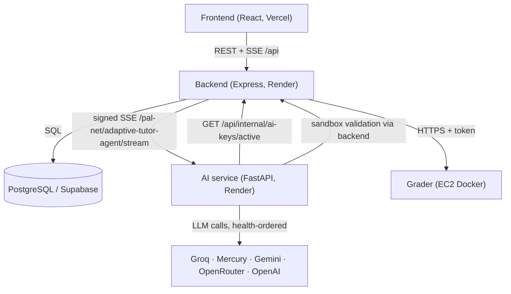

# PROJECT ARCHITECTURE & DESIGN SPECIFICATION

> **Agent Instruction**: Single source of truth for system architecture. Keep it in step with the code (last revised 2026-11-21).

---

## 1. Core Tech Stack
- **Backend**: Node.js 22, Express 5, Prisma 7 (PrismaPg adapter + `pg`), TypeScript — Render.
- **Frontend**: React 19, Vite, TanStack Query 5, React Router 7, Tailwind CSS 4, Monaco Editor — Vercel.
- **AI service**: Python 3.11, FastAPI, PyTorch (PAL-Net / DKT / BKT), multi-agent tutor pipeline — Render (`codehub-ai`).
- **Grader**: `grader-service/` on a dedicated EC2 host; Docker per submission (Python, JavaScript, C, C++, SQL via a Python/SQLite wrapper).
- **Storage**: PostgreSQL (Supabase). Adaptive tutor tables are created additively at startup (`adaptiveRepository.schemaStatements`).
- **LLM providers**: Groq, Inception (Mercury), Gemini, OpenRouter, OpenAI; keys live in `ai_provider_keys` (Admin → AI Keys).
- **Tests / CI**: `ai-service` pytest, `backend` `node --test` (on `dist/`), `frontend` node + Vite SSR tests; `.github/workflows/ci.yml` runs all three.

## 2. Directory Layout & Module Boundaries
- `backend/src/modules/` — feature modules: `adaptive` (AI Tutor runs, batches, grading), `ai-keys` (key pool, call logs, provider stats), `learning-path`, `courses`, `exercises`, `practice`, `onboarding`, `admin`, …
  - `adaptive/exerciseBatch.ts` — pure rules for multi-exercise batches and the per-session lock.
  - `adaptive/adaptiveRetryWorker.ts` — retries `WAITING_PROVIDER` runs, closes orphaned runs, creates the batch-position index.
- `frontend/src/features/` — `adaptive-learning` (AI Tutor page, batch resume rules in `batchResume.ts`), `ai-tutor`, `admin`, `course`, `lesson`, `practice`, …
- `ai-service/app/` — `orchestrator/flows` (routing, generation, resume), `agents` (router, planner, generator, repair, explanation, critic), `validation`, `llm/pipeline` (provider client, health, catalog, transport), `knowledge_tracing`, `legacy`.
- `grader-service/` — isolated execution API and runner images.

## 3. System Data Flow & Topology

Exercise generation (one AI Tutor turn):
1. Backend `chat()` takes the session lock, creates an `adaptive_generation_runs` row and streams the AI service.
2. AI service: router → prerequisite advisor → planner → grounding → generator → schema + constraint checks (errors reported together) → sandbox run on EC2 → explanation → critic (prefers a provider other than the generator's) → publication gate. Up to 3 repair turns.
3. Provider failures: `WAITING_PROVIDER` + retry worker; model overload / timeouts move to the next provider at once.

Practice batches (2–5 exercises): position 1 comes from the learner's turn; the browser then requests positions 2..N one by one. Progress is persisted on the batch card after every position (also from the retry worker). If the page reloads, the tab resumes from `GET /adaptive/batch/:traceId`. The batch is published only when every position holds a verified exercise.

## 4. Key Architectural Invariants
- **Learner code never runs on the backend host**: every execution goes to the EC2 grader (no network, read-only root, non-root, bounded resources).
- **Nothing unverified is published**: an exercise needs schema + constraint + sandbox + critic + PublicationGate; there is no template fallback in the adaptive pipeline.
- **Hidden tests and reference solutions never reach the learner** (public views strip them).
- **One in-flight turn per chat session** (`SessionLock`), **one in-flight run per batch position** (partial unique index `adaptive_runs_batch_position_inflight`), runs silent for 10 minutes are closed as `RUN_ORPHANED`.
- **Provider order is health-aware**: default Groq → Inception → Gemini → OpenRouter → OpenAI (`ADAPTIVE_PROVIDER_ORDER`); providers with repeated slow failures move last for 5 minutes; a model-wide overload isolates that model for every key.
- **Schema changes are additive** (`CREATE … IF NOT EXISTS`, `ADD COLUMN IF NOT EXISTS`).
- **PAL-Net bundles and module-practice content are SHA-256 pinned**; fix content through backend patches, not by editing pinned fields.
