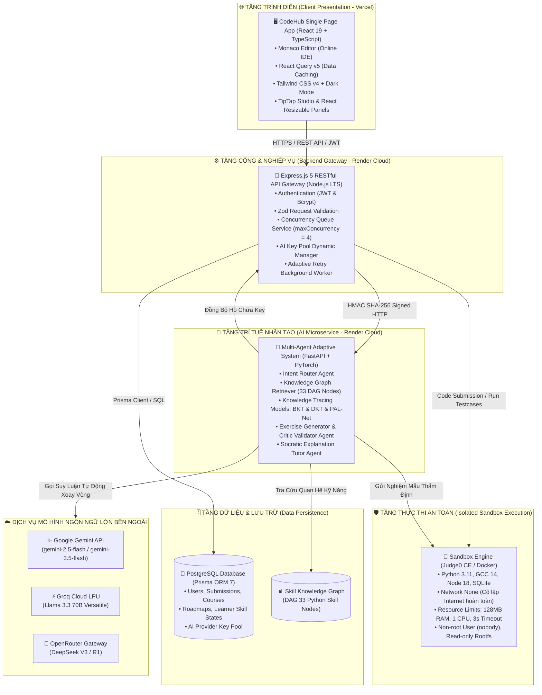
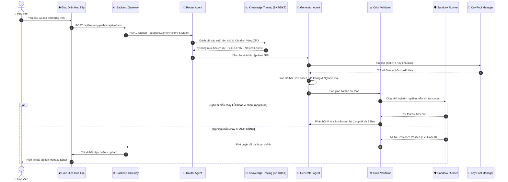
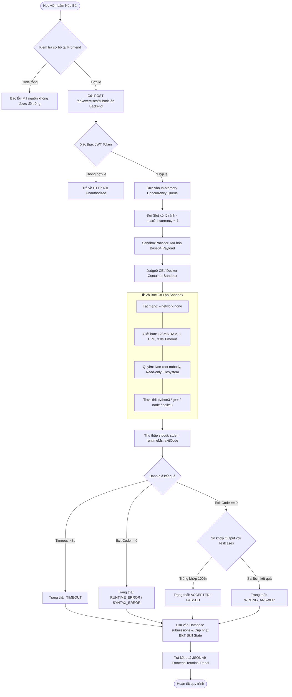

# 🏛️ ĐẶC TẢ KIẾN TRÚC HỆ THỐNG CODEHUB (LEARNPYTHON) - BẢN THIẾT KẾ DỰNG HÌNH

> **Mục đích tài liệu:** Tài liệu này mô tả chi tiết, tường minh toàn bộ cấu trúc kiến trúc, các khối thành phần, giao thức kết nối và luồng tương tác của hệ thống CodeHub (LearnPython). Bạn có thể sao chép trực tiếp nội dung văn bản này đưa vào các AI chuyên vẽ hình (như **Napkin AI**, **Eraser.io**, **ChatGPT**, **Claude**, **Mermaid Chart**, **PlantUML**, hoặc **Draw.io AI**) để tự động vẽ ra các sơ đồ kiến trúc hệ thống chuẩn quốc tế.

---

## 📑 MỤC LỤC
1. [Tóm Tắt Tổng Quan Kiến Trúc (Architecture Overview Prompt)](#1-tóm-tắt-tổng-quan-kiến-trúc)
2. [Mô Tả Kiến Trúc Phân Tầng (Layered Architecture Specification)](#2-mô-tả-kiến-trúc-phân-tầng)
3. [Đặc Tả Chi Tiết Từng Phân Hệ (Component Deep-Dive)](#3-đặc-tả-chi-tiết-từng-phân-hệ)
   - [3.1. Tầng Trình Diễn: Frontend Web Client (React 19)](#31-tầng-trình-diễn-frontend-web-client-react-19)
   - [3.2. Tầng Nghiệp Vụ & Cổng Điều Phối: Backend Gateway (Node.js/Express)](#32-tầng-nghiệp-vụ--cổng-điều-phối-backend-gateway-nodejsexpress)
   - [3.3. Tầng Trí Tuệ Nhân Tạo & Thích Ứng: AI Microservice (FastAPI/PyTorch)](#33-tầng-trí-tuệ-nhân-tạo--thích-ứng-ai-microservice-fastapipytorch)
   - [3.4. Tầng Hạ Tầng & Cách Ly: Code Execution Sandbox (Judge0 / Docker)](#34-tầng-hạ-tầng--cách-ly-code-execution-sandbox-judge0--docker)
   - [3.5. Tầng Lưu Trữ & Dữ Liệu: Data Persistence Layer (PostgreSQL & Vector/DAG)](#35-tầng-lưu-trữ--dữ-liệu-data-persistence-layer-postgresql--vectordag)
4. [Đặc Tả Các Luồng Hoạt Động Cốt Lõi (Core Data Flows)](#4-đặc-tả-các-luồng-hoạt-động-cốt-lõi)
   - [Luồng 1: Nộp Bài & Thực Thi Code An Toàn Trong Sandbox](#luồng-1-nộp-bài--thực-thi-code-an-toàn-trong-sandbox)
   - [Luồng 2: Khảo Sát Pre-test, Đánh Giá Tri Thức & Khởi Tạo Roadmap](#luồng-2-khảo-sát-pre-test-đánh-giá-tri-thức--khởi-tạo-roadmap)
   - [Luồng 3: Tương Tác Gia Sư AI & Chu Trình Sinh Đề Thích Ứng (Multi-Agent)](#luồng-3-tương-tác-gia-sư-ai--chu-trình-sinh-đề-thích-ứng-multi-agent)
   - [Luồng 4: Phân Phối & Tự Động Xoay Vòng Hồ Chứa Khóa AI (Dynamic Key Pool)](#luồng-4-phân-phối--tự-động-xoay-vòng-hồ-chứa-khóa-ai-dynamic-key-pool)
5. [Mã Sơ Đồ Mermaid Tích Hợp Sẵn (Ready-to-Render Diagrams)](#5-mã-sơ-đồ-mermaid-tích-hợp-sẵn)
   - [5.1. Sơ đồ Kiến trúc Tổng thể (System Context & Containers)](#51-sơ-đồ-kiến-trúc-tổng-thể-c4-container-diagram)
   - [5.2. Sơ đồ Pipeline Đa Tác Tử (Multi-Agent Architecture)](#52-sơ-đồ-pipeline-đa-tác-tử-multi-agent-system)
   - [5.3. Sơ đồ Luồng Chấm Mã Nguồn Sandbox](#53-sơ-đồ-luồng-chấm-mã-nguồn-sandbox-execution-flow)
6. [Bảng Màu & Hướng Dẫn Prompt Mỹ Thuật Cho AI Tạo Ảnh (Visual Style Guide)](#6-bảng-màu--hướng-dẫn-prompt-mỹ-thuật-cho-ai-tạo-ảnh)

---

## 1. TÓM TẮT TỔNG QUAN KIẾN TRÚC

* **Tên hệ thống:** CodeHub (LearnPython Ecosystem).
* **Mô hình kiến trúc:** 3-Tier Distributed Architecture / Microservices-Oriented kết hợp Multi-Agent AI System.
* **Môi trường triển khai:**
  * **Frontend Client:** Triển khai trên **Vercel Edge Network** (Giao thức HTTPS).
  * **Backend API Gateway:** Triển khai trên **Render Cloud** (Node.js Docker Web Service).
  * **AI Microservice:** Triển khai trên **Render Cloud** (Python FastAPI Web Service).
  * **Database Layer:** Cơ sở dữ liệu quan hệ **PostgreSQL Cloud** (Supabase / Render Postgres).
  * **Execution Sandbox:** Hạ tầng thực thi mã nguồn cô lập (**Judge0 CE Sandbox** / **Docker Container**).

```text
               ┌─────────────────────────────────────────────────────┐
               │         🌐 FRONTEND SPA (React 19 + Vite 8)         │
               │   Monaco Editor • React Query • Tailwind • TipTap   │
               └──────────────────────────┬──────────────────────────┘
                                          │
                                 HTTPS / RESTful API
                                 JWT Bearer Tokens
                                          ▼
               ┌─────────────────────────────────────────────────────┐
               │    ⚙️ BACKEND API GATEWAY (Node.js + Express 5)     │
               │   Auth • Courses • Practice • Roadmap • Key Pool    │
               └──────────────┬────────────────────────┬─────────────┘
                              │                        │
         HMAC-SHA256 Internal │                        │ SQL Queries
         Payload Verification │                        │ Prisma ORM 7
                              ▼                        ▼
┌──────────────────────────────────────────┐  ┌──────────────────────────────┐
│  🤖 AI ADAPTIVE SERVICE (FastAPI)        │  │  🐘 POSTGRESQL DATABASE      │
│  • Multi-Agent Orchestrator              │  │  • Users, Courses, Roadmaps  │
│  • Knowledge Tracing: BKT, DKT, PAL-Net  │  │  • Submissions, Progress     │
│  • LLM Gateway: Gemini, Groq, DeepSeek   │  │  • Dynamic AI Provider Keys  │
└─────────────────────┬────────────────────┘  └──────────────────────────────┘
                      │
                      │ REST API (POST /submissions)
                      │ Code Sandbox Execution
                      ▼
┌────────────────────────────────────────────────────────────────────────────┐
│         🛡️ CODE EXECUTION SANDBOX (Judge0 CE / Docker Isolation)           │
│         Python 3.11 • C++ GCC 14 • Node.js 18 • SQLite                     │
│         Cgroups Limit (128MB RAM, 1 CPU, Network None, PIDs Limit)         │
└────────────────────────────────────────────────────────────────────────────┘
```

---

## 2. MÔ TẢ KIẾN TRÚC PHÂN TẦNG

Hệ thống được chia thành 5 tầng độc lập với ranh giới trách nhiệm rõ ràng (Separation of Concerns):

1. **Tầng Trình Diễn (Presentation Layer):**
   * Chạy hoàn toàn trên trình duyệt người dùng dưới dạng Single Page Application (SPA).
   * Cung cấp không gian lập trình chuyên nghiệp (Online IDE) tích hợp trình biên soạn mã nguồn Monaco Editor, kéo thả phân chia khu vực học tập và giao diện trò chuyện cùng trợ lý gia sư AI.

2. **Tầng Cổng Điều Phối & Nghiệp Vụ (API Gateway & Business Layer):**
   * Điểm tiếp nhận duy nhất cho mọi yêu cầu từ Frontend.
   * Xử lý xác thực người dùng, phân quyền truy cập (RBAC), kiểm soát nghiệp vụ khóa học, quản lý hàng đợi chấm bài (In-Memory Queue), và điều phối hồ chứa khóa API của các mô hình ngôn ngữ lớn (LLM Key Pool).

3. **Tầng Trí Tuệ Thích Ứng (Adaptive AI Intelligence Layer):**
   * Đóng vai trò là "bộ não" tính toán cá nhân hóa của hệ thống.
   * Kết hợp Đồ thị Tri thức Kỹ năng (Skill Knowledge Graph DAG) và các mô hình học sâu/xác suất (BKT, DKT, PAL-Net) để định lượng chính xác năng lực người học, xác định Vùng phát triển gần nhất (ZPD), từ đó điều khiển chu trình Multi-Agent sinh bài tập và phản hồi tự động.

4. **Tầng Thực Thi An Toàn (Isolated Execution Sandbox Layer):**
   * Đảm nhiệm việc biên dịch và chạy thử nghiệm mã nguồn do học viên nộp cũng như mã nguồn mẫu do AI sinh ra.
   * Cách ly hoàn toàn khỏi mạng Internet, giới hạn nghiêm ngặt về tài nguyên CPU, RAM, thời gian chạy và số lượng tiến trình nhằm loại trừ 100% rủi ro mã độc hại.

5. **Tầng Lưu Trữ & Dữ Liệu (Data Persistence Layer):**
   * Lưu trữ bền vững dữ liệu quan hệ, tiến độ học tập, lịch sử nộp bài, trạng thái kỹ năng và cấu hình hệ thống thông qua cơ chế ánh xạ đối tượng Prisma ORM kết hợp PostgreSQL.

---

## 3. ĐẶC TẢ CHI TIẾT TỪNG PHÂN HỆ

### 3.1. Tầng Trình Diễn: Frontend Web Client (React 19)
* **Công nghệ cốt lõi:** React 19, TypeScript 6.0, Vite 8, Tailwind CSS v4.
* **Kiến trúc mã nguồn:** Tổ chức theo mô hình **Feature-Driven Architecture** (chia theo từng miền tính năng độc lập tại `src/features/`):
  1. `features/onboarding`: Khảo sát mục tiêu ban đầu, bài thi đánh giá năng lực đầu vào (Pre-test 6 câu hỏi đo lường đa năng lực) và hiển thị Cây lộ trình cá nhân hóa (Personalized Roadmap).
  2. `features/practice`: Đấu trường luyện tập lập trình (Coding Arena), danh sách bài tập chia theo chủ đề và mức độ khó (Easy, Medium, Hard).
  3. `features/lesson`: Hiển thị nội dung bài học lý thuyết, video bài giảng phân chia theo chapter, câu hỏi trắc nghiệm tương tác nhanh (Quiz).
  4. `features/adaptive-learning`: Không gian thực hành thích ứng thời gian thực; học viên làm bài theo các chặng kỹ năng do AI đề xuất.
  5. `features/ai-tutor`: Khung chat tương tác với trợ lý gia sư AI Mascot (hướng dẫn tư duy gợi mở theo phương pháp Socratic, phân tích lỗi cú pháp và gợi ý hướng giải).
  6. `features/admin`: Bảng điều khiển quản trị viên (Admin Dashboard), quản lý học viên, quản lý ngân hàng câu hỏi, soạn thảo giáo trình TipTap và quản lý trạng thái hồ chứa AI Keys.
* **Thành phần kỹ thuật nổi bật:**
  * **Monaco Editor:** Trình soạn thảo mã nguồn giống Visual Studio Code, hỗ trợ highlight cú pháp, tự động thụt lề và phím tắt.
  * **React Resizable Panels:** Kéo thả linh hoạt thanh chia tách màn hình (chia đôi khu vực xem đề bài và khu vực gõ code / terminal).
  * **TanStack Query v5:** Quản lý đồng bộ trạng thái máy chủ (Server State), tự động cache dữ liệu 5 phút, hạn chế tối đa lượt gọi mạng dư thừa.

---

### 3.2. Tầng Nghiệp Vụ & Cổng Điều Phối: Backend Gateway (Node.js/Express)
* **Công nghệ cốt lõi:** Node.js (LTS), Express 5, TypeScript 6.0, Prisma ORM 7.8, PostgreSQL.
* **Cơ chế bảo mật & Xác thực:**
  * **JWT (JSON Web Token):** Xác thực không lưu trạng thái (Stateless Authentication) đính kèm qua HTTP Bearer Header.
  * **Bcrypt.js:** Mã hóa băm mật khẩu học viên 1 chiều với chuỗi muối (Salt rounds).
  * **HMAC SHA-256 Request Signing:** Cơ chế ký số bí mật (`x-adaptive-signature`, `x-adaptive-timestamp`) ngăn chặn việc giả mạo request giữa Backend và AI Service.
  * **Zod v4:** Kiểm tra tính hợp lệ và cấu trúc dữ liệu nghiêm ngặt của mọi payload trước khi đi vào controller.
* **Các dịch vụ hạ tầng bên trong Backend:**
  * **Code Execution Queue (`queueService.ts`):** Hàng đợi điều tiết luồng thực thi code với `maxConcurrency = 4`, tự động gom nhóm bài nộp, bảo vệ CPU máy chủ không bị nghẽn khi có nhiều người nộp bài cùng thời điểm.
  * **AI Key Pool Manager (`aiKey.controller.ts`):** Cơ chế quản lý tập trung hàng chục API key của Gemini, Groq, OpenRouter; tự động phân bổ cho AI service, theo dõi lỗi quá hạn mức (Rate Limit / Quota Exceeded) để chuyển đổi key dự phòng tức thì.
  * **Adaptive Retry Worker (`adaptiveRetryWorker.ts`):** Tiến trình ngầm tự động tìm kiếm và khôi phục các tác vụ sinh bài tập AI bị gián đoạn do sự cố mạng.

---

### 3.3. Tầng Trí Tuệ Nhân Tạo & Thích Ứng: AI Microservice (FastAPI/PyTorch)
* **Công nghệ cốt lõi:** Python 3.11, FastAPI, Uvicorn, PyTorch (CPU Mode), NetworkX (Đồ thị kỹ năng), Pydantic v2.
* **Kiến trúc Đa Tác Tử (Multi-Agent System Pipeline):**
  1. **Router Agent:** Tiếp nhận yêu cầu của người học, phân tích ngôn ngữ tự nhiên để xác định đúng ý định (Hỏi đáp lý thuyết, giải thích lỗi sai, yêu cầu sinh bài tập mới, hay than phiền về độ khó).
  2. **Knowledge Retriever:** Tra cứu Đồ thị Kỹ năng Python (`skill_graph.json` gồm 33 nodes kiến thức chuẩn) để xác định vị trí hiện tại của học viên và các kỹ năng tiên quyết (Prerequisites).
  3. **Mô hình Đánh Giá Tri Thức (Knowledge Tracing Engine):**
     * **BKT (Bayesian Knowledge Tracing):** Mô hình xác suất cập nhật trạng thái làm chủ từng khái niệm $P(L_t)$ dựa trên lịch sử đúng/sai.
     * **DKT (Deep Knowledge Tracing):** Mạng thần kinh hồi quy LSTM (PyTorch) dự đoán xác suất làm đúng các câu hỏi tiếp theo dựa trên chuỗi tương tác dài hạn.
     * **PAL-Net (Path-Adaptive Learning Network):** Mạng nơ-ron đồ thị định vị Vùng phát triển gần nhất (ZPD - Zone of Proximal Development), đảm bảo bài tập đưa ra không quá dễ gây nhàm chán, cũng không quá khó gây nản lòng.
  4. **Exercise Generator Agent:** Sử dụng mô hình ngôn ngữ lớn (LLM) để sinh ra đề bài, các ràng buộc kỹ thuật (bắt buộc dùng vòng lặp, cấm dùng đệ quy...), mã khung khởi tạo và bộ kiểm thử (gồm test cases công khai và test cases ẩn).
  5. **Critic & Sandbox Validator Agent:** Tự động giải thử bài tập vừa sinh bằng mã nghiệm mẫu (`reference_solution`) và gửi sang Sandbox để chạy thử nghiệm. Chỉ khi bài tập chạy thành công và thỏa mãn mọi ràng buộc mới chính thức phát hành cho học viên.
  6. **Explanation Tutor Agent:** Đóng vai trò gia sư sư phạm, hỗ trợ giải thích các thông báo lỗi runtime phức tạp thành lời khuyên dễ hiểu bằng tiếng Việt.

---

### 3.4. Tầng Hạ Tầng & Cách Ly: Code Execution Sandbox (Judge0 / Docker)
* **Công nghệ:** Judge0 CE (Public/Self-hosted API) hoặc Docker Container Isolation.
* **Nguyên tắc bảo mật:** Chế độ **Fail-Closed** và **Zero-Trust** với mã nguồn người dùng:
  * **Cách ly mạng tuyệt đối (`--network none`):** Mã nguồn thực thi không thể mở socket, không thể gửi dữ liệu ra ngoài Internet hoặc kết nối vào cơ sở dữ liệu nội bộ.
  * **Giới hạn tài nguyên cứng (Hard Resource Limits):**
    * Giới hạn bộ nhớ: Tối đa 128MB RAM (64MB đối với C/C++).
    * Giới hạn thời gian CPU: Tối đa 3.0 giây (ngăn chặn vòng lặp vô hạn `while True`).
    * Giới hạn tiến trình (`--pids-limit 64`): Ngăn chặn triệt để tấn công Fork-bomb.
  * **Quyền hạn tối thiểu (Least Privilege):** Chạy dưới người dùng không đặc quyền (`nobody / 65534`), tước bỏ toàn bộ Linux Kernel Capabilities (`--cap-drop ALL`), hệ thống tệp chỉ đọc (`--read-only`) và chỉ cho phép ghi tạm tại phân vùng bộ nhớ đệm `/tmp`.
* **Hỗ trợ đa môi trường:**
  * Python 3.11 (Judge0 ID: `92`)
  * JavaScript Node 18 (Judge0 ID: `93`)
  * C++ GCC 14 (Judge0 ID: `105`)
  * C GCC 14 (Judge0 ID: `104`)
  * SQL SQLite (Judge0 ID: `82`)

---

### 3.5. Tầng Lưu Trữ & Dữ Liệu: Data Persistence Layer (PostgreSQL & Vector/DAG)
* **PostgreSQL Schema:** Được quản lý đồng bộ qua Prisma ORM với hơn 30 bảng quan hệ chặt chẽ:
  * Nhóm tài khoản & phân quyền: `users`, `roles`, `certificates`.
  * Nhóm khóa học & bài giảng: `courses`, `modules`, `lessons`, `quizzes`, `quiz_options`.
  * Nhóm bài tập & chấm điểm: `practice_problems`, `practice_test_cases`, `submissions`, `submission_test_results`.
  * Nhóm học tập thích ứng: `learner_surveys`, `pretest_attempts`, `learner_skill_states`, `roadmaps`, `adaptive_generation_runs`, `adaptive_submissions`, `learning_interactions`.
  * Nhóm hạ tầng AI: `a_i_provider_keys` (lưu trữ hồ chứa khóa thông minh).

---

## 4. ĐẶC TẢ CÁC LUỒNG HOẠT ĐỘNG CỐT LÕI

### Luồng 1: Nộp Bài & Thực Thi Code An Toàn Trong Sandbox
```text
[Học Viên] 
   │ 1. Viết code & bấm "Nộp Bài"
   ▼
[Frontend: PracticeWorkspace.tsx]
   │ 2. Gửi HTTP POST /api/exercises/submit (Kèm JWT Token & Code)
   ▼
[Backend: exerciseController.ts]
   │ 3. Đưa yêu cầu vào In-Memory Concurrency Queue
   ▼
[Backend: queueService.ts / SandboxService]
   │ 4. Mã hóa Base64 code và test cases, gọi sang Sandbox Engine
   ▼
[Sandbox Engine: Judge0 CE / Docker Container]
   │ 5. Khởi tạo môi trường cô lập (--network none, RAM 128MB, CPU 3s)
   │ 6. Biên dịch và thực thi mã nguồn với từng testcase
   │ 7. Bắt đầu ra stdout, stderr, mã thoát (exit code), thời gian chạy (runtimeMs)
   ▼
[Backend: exerciseController.ts]
   │ 8. So khớp output với kết quả kỳ vọng (Exact match hoặc JSON Normalizer)
   │ 9. Lưu bản ghi kết quả nộp bài vào bảng `submissions` trong PostgreSQL
   │ 10. Ghi nhận sự kiện học tập (Learning Event) để cập nhật độ làm chủ kỹ năng
   ▼
[Frontend: PracticeWorkspace.tsx]
   │ 11. Nhận JSON kết quả và hiển thị trực quan lên Terminal (Xanh: Accepted / Đỏ: Error)
```

---

### Luồng 2: Khảo Sát Pre-test, Đánh Giá Tri Thức & Khởi Tạo Roadmap
```text
[Học Viên Mới]
   │ 1. Trả lời khảo sát mục tiêu (Mới bắt đầu / Đã biết cơ bản / Luyện thuật toán)
   ▼
[Frontend: PretestPage.tsx]
   │ 2. Làm bài kiểm tra năng lực đầu vào 6 câu hỏi đa dạng độ khó
   │ 3. Gửi bài nộp qua POST /api/pretests/submit
   ▼
[Backend: pretestRuntimeService.ts]
   │ 4. Chấm điểm bài làm trong Sandbox cách ly
   │ 5. Chuyển tiếp hồ sơ kết quả sang AI Service qua POST /adaptive/assess-pretest
   ▼
[AI Service: Knowledge Tracing Engine (BKT / DKT)]
   │ 6. Ánh xạ kết quả các câu hỏi lên Đồ thị Kỹ năng (Skill Graph DAG)
   │ 7. Tính toán ma trận xác suất làm chủ năng lực ban đầu cho 33 nodes kỹ năng
   │ 8. Thuật toán quy hoạch lộ trình (Topological Sort + ZPD) tìm đường đi tối ưu
   ▼
[Backend: roadmapRuntimeRoutes.ts]
   │ 9. Lưu cấu trúc Cây lộ trình (Milestones & Nodes) vào bảng `roadmaps`
   ▼
[Frontend: RoadmapPage.tsx]
   │ 10. Hiển thị đồ thị kiến thức trực quan: Các node đã mở khóa, đang học và bị khóa
```

---

### Luồng 3: Tương Tác Gia Sư AI & Chu Trình Sinh Đề Thích Ứng (Multi-Agent)
```text
[Học Viên Gặp Khó Khăn / Cần Bài Mới]
   │ 1. Nhập câu hỏi hoặc bấm "Nhận bài tập thích ứng tiếp theo"
   ▼
[Frontend: AITutorChat.tsx / AdaptivePractice.tsx]
   │ 2. Gửi request kèm ngữ cảnh (Context: mã bài hiện tại, log lỗi, kỹ năng đang học)
   ▼
[Backend: learningPath.controller.ts]
   │ 3. Ký số HMAC SHA-256 xác thực nguồn gốc
   │ 4. Chuyển tiếp sang AI Service qua endpoint Streaming hoặc REST API
   ▼
[AI Service: Multi-Agent Orchestrator]
   │ 5. RouterAgent: Xác định mục tiêu là "Sinh bài tập mới"
   │ 6. KnowledgeRetriever: Đọc đồ thị kỹ năng để lấy node ZPD mục tiêu
   │ 7. KeyPoolManager: Thuê 1 API Key khả dụng (Gemini Flash / Groq)
   │ 8. GeneratorAgent: Sử dụng Few-shot Prompting sinh đề bài, code mẫu và testcases
   │ 9. CriticAgent: Gửi nghiệm mẫu sang Sandbox chạy thử nghiệm tự động:
   │      - Nếu fail: Yêu cầu GeneratorAgent sửa lại đề bài (tối đa 3 vòng lặp)
   │      - Nếu pass: Phê duyệt đề bài đạt chuẩn sư phạm
   ▼
[Backend: adaptiveInternalRouter.ts]
   │ 10. Nhận đề bài đã kiểm định, lưu vào bảng `adaptive_generation_runs`
   ▼
[Frontend: PersonalizedPathWorkspace.tsx]
   │ 11. Mở không gian làm bài tập độc quyền do AI thiết kế riêng cho học viên
```

---

### Luồng 4: Phân Phối & Tự Động Xoay Vòng Hồ Chứa Khóa AI (Dynamic Key Pool)
```text
[Quản Trị Viên (Admin)]
   │ 1. Nhập danh sách các API Keys (Gemini, Groq, OpenRouter) trên trang quản trị
   ▼
[Backend: aiKey.controller.ts]
   │ 2. Mã hóa an toàn và lưu trữ vào bảng `a_i_provider_keys` trong PostgreSQL
   │ 3. Cung cấp API nội bộ: GET /api/internal/ai-keys/active
   ▼
[AI Service: key_pool_manager.py]
   │ 4. Định kỳ đồng bộ danh sách key từ Backend hoặc tự động kích hoạt khi khởi động
   │ 5. Điều phối thuật toán xoay vòng Round-Robin phân phối đều tải các request
   │ 6. Nếu phát hiện mã lỗi HTTP 429 (Too Many Requests / Quota Exceeded):
   │      - Tạm thời vô hiệu hóa key bị cạn hạn mức trong hàng đợi
   │      - Tự động chuyển đổi request sang key kế tiếp ngay lập tức
   │      - Đảm bảo người học không bao giờ nhận thông báo lỗi gián đoạn dịch vụ
```

---

## 5. MÃ SƠ ĐỒ MERMAID TÍCH HỢP SẴN

*(Bạn có thể dán trực tiếp các đoạn mã dưới đây vào bất kỳ công cụ hỗ trợ Mermaid Markdown nào để xuất ra hình ảnh ngay lập tức).*

### 5.1. Sơ đồ Kiến trúc Tổng thể (C4 Container Diagram)



---

### 5.2. Sơ đồ Pipeline Đa Tác Tử (Multi-Agent System)



---

### 5.3. Sơ đồ Luồng Chấm Mã Nguồn Sandbox (Execution Flow)



---

## 6. BẢNG MÀU & HƯỚNG DẪN PROMPT MỸ THUẬT CHO AI TẠO ẢNH

Nếu bạn muốn đưa văn bản này vào các công cụ AI tạo ảnh trực quan (Midjourney, DALL-E 3, Ideogram, Napkin AI) để sinh ra poster hoặc infographic kiến trúc nghệ thuật, hãy sử dụng đoạn mô tả thiết kế chuẩn sau:

### 🎨 Bảng mã màu khuyến nghị (Color Palette):
* **Nền tảng (Dark Canvas):** `#0F172A` (Slate 900) hoặc `#0A0F1D` (Deep Navy Cyber).
* **Tầng Trình diễn (Frontend Layer):** `#06B6D4` (Cyan Neon) kết hợp `#3B82F6` (Electric Blue).
* **Tầng Cổng & Nghiệp vụ (Backend Layer):** `#10B981` (Emerald Green) kết hợp `#6366F1` (Indigo).
* **Tầng Trí tuệ Nhân tạo (AI & Agents):** `#8B5CF6` (Purple Violet) kết hợp `#EC4899` (Fuchsia Pink).
* **Tầng Hạ tầng Sandbox (Security Layer):** `#F59E0B` (Amber Shield) kết hợp `#EF4444` (Coral Red Alert).
* **Tầng Cơ sở Dữ liệu (Database Layer):** `#38BDF8` (Sky Blue) kết hợp `#94A3B8` (Cool Grey).

### 📝 Prompt mẫu cho AI tạo sơ đồ (Copy-Paste Prompt):
> *"A high-end, futuristic enterprise software architecture diagram infographic for an adaptive AI coding platform named 'CodeHub'. Clean dark mode visual aesthetic with sleek glassmorphism panels, glowing neon data pipeline connectors, and subtle isometric server racks. Five distinct vertical layers: Top layer is modern web client (React, Monaco Editor UI), second layer is API Gateway (Node.js, Express), third layer is Multi-Agent AI Core (Brain icon, neural network DAG, PyTorch), fourth layer is Isolated Security Sandbox (Shield icon, Docker container with padlocks and resource limits), bottom layer is PostgreSQL database storage. Vibrant cyan, electric blue, and violet neon accents on deep obsidian background. Highly technical, structured, sharp typography, professional 8k tech diagram."*
